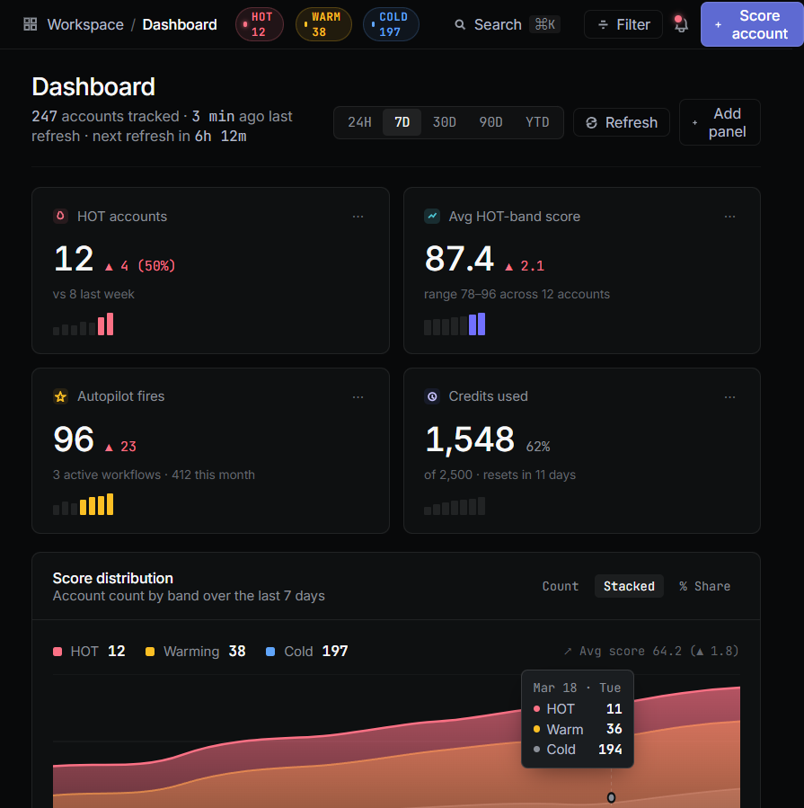
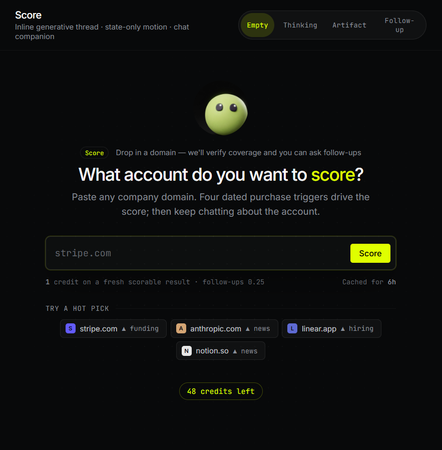
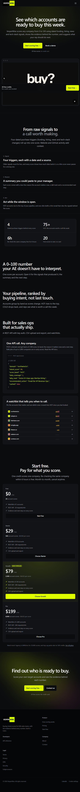
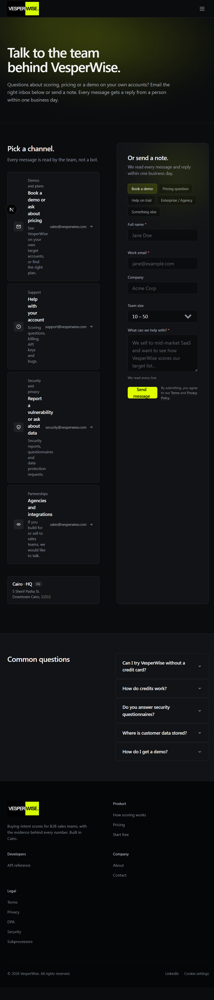
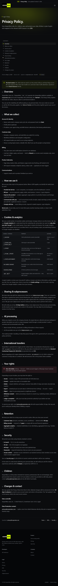
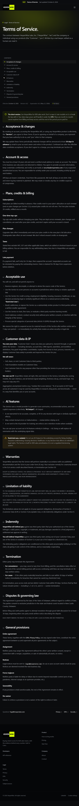
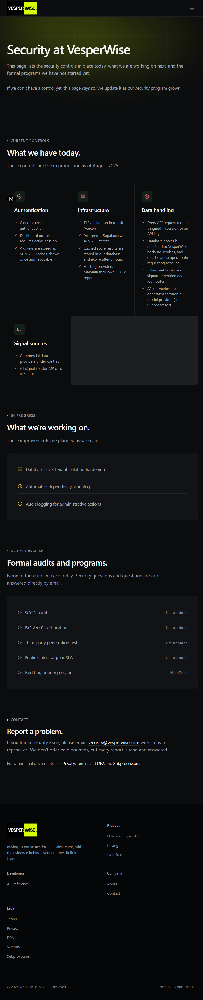
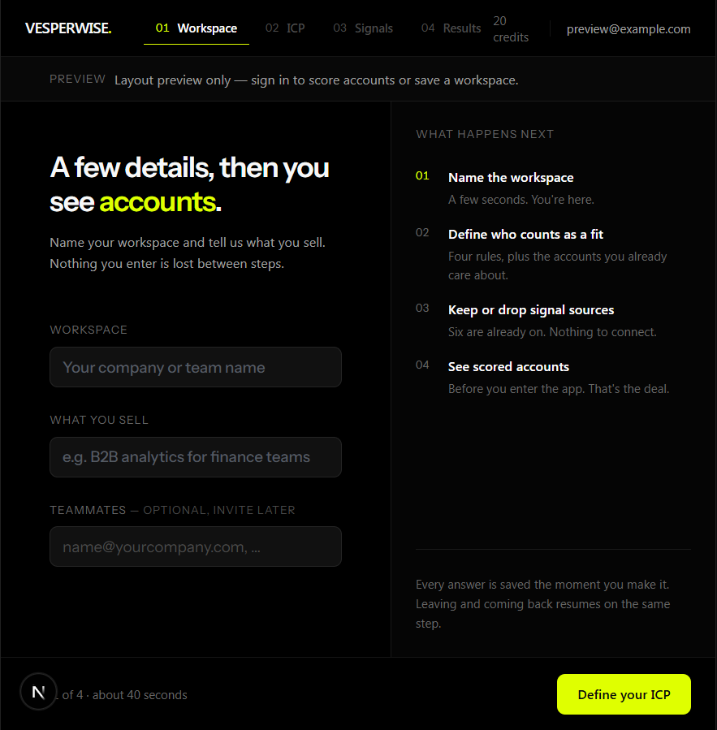
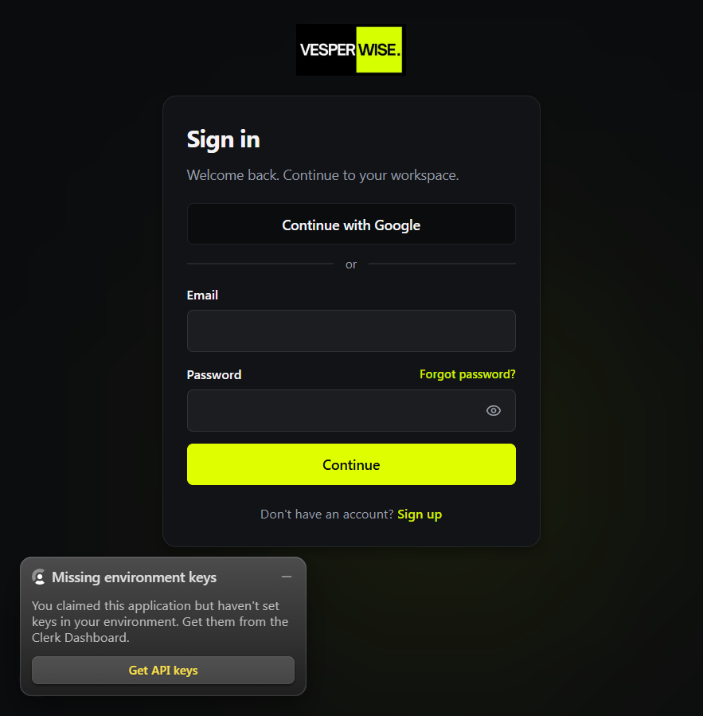
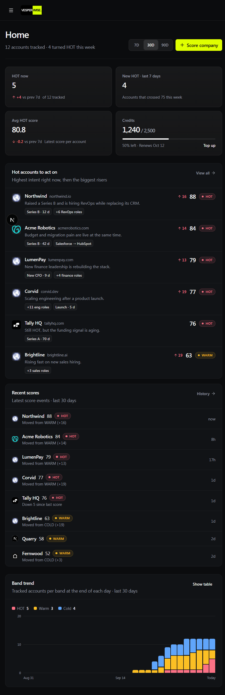

# VesperWise colour changes and screenshots

This report documents the recent colour pass and embeds screenshots for every modified standalone page design, plus the relevant running app pages that were accessible in the local preview.

## Palette

| Use | Colour | Hex |
|---|---|---|
| Brand | Classic VesperWise lime | `#dfff00` |
| HOT | Coral | `#fb7185` |
| WARM | Amber | `#fbbf24` |
| COLD | Blue | `#60a5fa` |

The brand lime stays the brand colour. HOT, WARM, and COLD remain separate semantic status colours. The brighter `#e8ff40` remains available as a hover state.

## What changed

- Shared theme colours in [app/globals.css](../../app/globals.css) now define HOT as coral, WARM as amber, and COLD as blue. Chart colours follow those tokens. Decorative places that used the near-lime `#e8ff40` now use classic lime `#dfff00`.
- The dashboard trend chart in [components/dashboard/home/band-trend.tsx](../../components/dashboard/home/band-trend.tsx) previously used the generic foreground colour for HOT. In dark mode that is near-white, which caused the white bars. HOT now uses `var(--hot)`.
- People and History score rings use the matching semantic colour for their band. Their signal accents and decorative avatar colours were aligned with the palette in [app/(dashboard)/people/people-view.tsx](../../app/(dashboard)/people/people-view.tsx), [app/(dashboard)/history/history-view.tsx](../../app/(dashboard)/history/history-view.tsx), and [components/history/history-run-tab.tsx](../../components/history/history-run-tab.tsx).
- [design-reference/score-chat-prototype/index.html](../../design-reference/score-chat-prototype/index.html) uses the same HOT/WARM palette and classic lime for the technology signal.
- Shared theme and shell styles also affect other routes, so the running public pages below are included as visual checks.

## Modified standalone page designs

These are the eight modified `IntentIQ *.html` page designs in the project. Each screenshot is a full-page capture of that design.

### Dashboard design

### History design

### People design

### Score design

### Lists design

### Watchlist design

### Billing design

### Autopilot design

### Linear / landing design

### Score chat prototype

## Running app pages

Each screenshot below is from the running Next.js app. These pages share the updated global theme and provide the available route-level views.

### Landing page

### Contact

### API docs

### Privacy

### Terms

### Security

### Onboarding

### Sign in

### Dashboard preview with HOT trend chart

## Routes blocked by local sign-in

The live `/people` and `/history` dashboard routes redirect to sign-in in this local preview, so their authenticated app versions could not be captured. Their matching standalone designs are included above, and their React code changes are listed above. The dashboard chart itself is visible in the `/dev/preview` screenshot.
